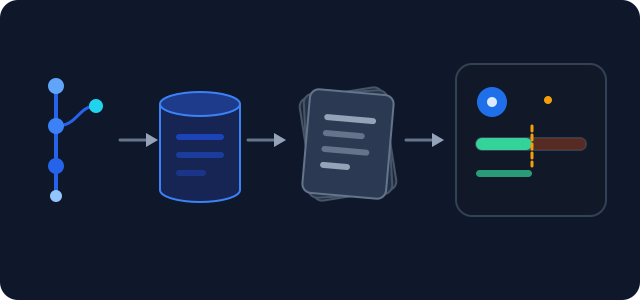

## Self-contained Hindsight Memory & Governance

`@jameryw/dsh-hindsight-tuner` runs **standalone as a single DSH plugin** with zero external npm or plugin dependencies:

- **Built-in Hindsight engine (`memoryLane: auto`)**: directly pulls `pages`, `recall`, or `reflect` context into turns, auto-wakes local `hindsight-embed` / `uvx` daemons (`serverMode: daemon`), syncs bank config via `/import` (`manageBankConfig`), replays `401` on live token changes, and incrementally retains completed DSH session turns (`agent/turn-stopping` & `agent/disposed`) with automatic credential redaction (`Bearer`, `sk-*`, `apiToken`, etc.).
- **Peaceful coexistence**: if `@vectorize-io/hindsight-coding-agents` is also installed and enabled, `memoryLane: auto` automatically yields recall fetching and tool registration while continuing to enforce outer token-budget governance without double-injecting.
- **Native agent tools**: `hindsight_tuner` (read-only diagnostics by default) plus `hindsight_search_pages`, `hindsight_list_pages`, `hindsight_read_page`, `hindsight_recall`, `hindsight_reflect`, `hindsight_retain`, `hindsight_ingest_document`, and `hindsight_capture_initiative`.
- **Hard token budget & framing**: enforces `maxInjectTokens` (with `fast` or built-in zero-dependency `calibrated` BPE accounting), adaptive/scenario tiers, `repeatPolicy: skip` + `new-facts delta`, compaction re-injection, `[snapshot #N]` headers, and untrusted-memory data boundaries.

## Slash Commands

- `/hindsight` or `/hindsight status [--json]` — health, active lane, effective config layers, and token budget report
- `/hindsight stats [--json]` — bank node/observation/link counts and page inventory
- `/hindsight pages [query] [--limit N]` — browse page tree or run hybrid search
- `/hindsight recall <query> [--limit N]` — retrieve atomic facts and experiences
- `/hindsight reflect <query>` — synthesize patterns across bank memories
- `/hindsight retain <note>` — save a verified project note (secrets auto-redacted)
- `/hindsight seed [--limit N]` — seed recent Git commits into the bank
- `/hindsight tune [--dry-run] [--overwrite] [--cap N]` / `/hindsight revert [--dry-run]` — apply or undo the shared `~/.hindsight/coding-agent.json` preset
