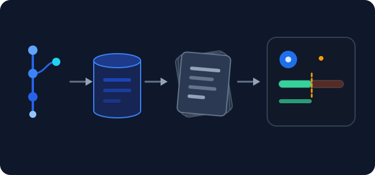

## 单插件独立完整 Hindsight 记忆引擎与预算治理

`@jameryw/dsh-hindsight-tuner` **零外部 npm 依赖、无需安装任何其他插件即可独立完整运行**：

- **内置完整 Hindsight 引擎（默认 `memoryLane: auto`）**：自动在每轮拉取 `pages`、`recall` 或 `reflect` 记忆，支持本地 `serverMode: daemon` 休眠后自动唤醒 `hindsight-embed` / `uvx`、支持 `manageBankConfig` 通过 `/import` 同步配置、支持 401 令牌热更新自动重放，并在真实 DSH 生命周期事件（`agent/turn-stopping`、`agent/disposed`）对已完成对话轮次执行幂等增量留存与自动敏感凭据脱敏（`Bearer`、`sk-*`、`apiToken` 等）。
- **无感共存保护**：若当前 Profile 同时启用了 `@vectorize-io/hindsight-coding-agents`，`memoryLane: auto` 会自动让出拉取与工具注册，仅保留外层 Token 预算治理与诊断，绝不重复注入。
- **内置原生工具**：`hindsight_tuner`（默认只读诊断）以及 `hindsight_search_pages`、`hindsight_list_pages`、`hindsight_read_page`、`hindsight_recall`、`hindsight_reflect`、`hindsight_sync_status`、`hindsight_diagnose`、`hindsight_retain`、`hindsight_ingest_document`、`hindsight_capture_initiative`。
- **严格预算与安全边界**：通过最外层 `agent/pre-step` 强制执行 `maxInjectTokens` 上限（发布预设默认启用内置零依赖 `calibrated` 结构化 BPE 分词，也可选 `fast`），支持自适应/场景分层预算、重复跳过与增量 `new-facts delta`、上下文压缩后安全重注入、`[snapshot #N]` 单调快照头与防提示注入数据边界包裹。

## 交互斜杠命令

- `/hindsight` 或 `/hindsight status [--json]` — 查看服务连通性、激活通道、多层生效配置与当前会话预算账本
- `/hindsight stats [--json]` — 查看当前 Bank 的记忆节点/观察/边统计与页面库存
- `/hindsight init [--limit N]` — 幂等初始化独立编码记忆库（同步提取策略、补齐核心页面模板并导入近期 Git 提交）
- `/hindsight pages [query] [--limit N]` — 浏览页面目录树或按关键词混合检索页面
- `/hindsight recall <query> [--limit N]` — 直接检索原子事实与历史经验
- `/hindsight reflect <query>` — 对当前记忆库执行反思综合
- `/hindsight retain <note>` — 手动记录项目经验（自动执行敏感凭据脱敏）
- `/hindsight seed [--limit N]` — 将当前仓库近期 Git 提交批量导入记忆库
- `/hindsight tune [--dry-run] [--overwrite] [--cap N]` / `/hindsight revert [--dry-run]` — 应用或精确回滚 `~/.hindsight/coding-agent.json` 共享精简预设
